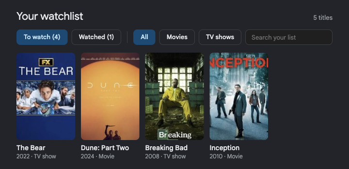

# Bring Back My Google Watchlist

**Google's Watchlist button keeps disappearing. This free browser extension brings it back.**

**[Download and install instructions →](https://kaizarraja.github.io/bring-back-my-google-watchlist/)**



It brings back Google's watchlist flow:

1. Search a movie or TV show on Google. An **Add to watchlist** button appears next to the year and genre under the title.
2. Search **my watchlist** on Google. Your list appears at the top of the results, with To watch / Watched tabs, a Movies / TV filter and a search box.
   - `my watchlist movies` and `my watchlist tv shows` open it already filtered.
3. Click the toolbar icon for the same list anywhere, plus backup and import.

Your list is saved in the browser. Click **Sign in with Google to sync** in the popup and it syncs, through this project's own small server, with every browser where you've signed in: Chrome, Brave, other computers.

## Install

Step-by-step instructions are on the [website](https://kaizarraja.github.io/bring-back-my-google-watchlist/#install). In short: download `bring-back-my-google-watchlist.zip`, unzip it somewhere permanent, open `chrome://extensions` (Brave and Edge work too), turn on **Developer mode**, click **Load unpacked** and choose the `bring-back-my-google-watchlist` folder.

To work on the code, load the `extension` folder from this repository instead. After you edit a file, press the reload arrow on the extension's card.

## Bring over your old Google watchlist

1. Click the toolbar icon, then **Import from Google**. This opens `google.com/interests/saved`.
2. Open your **Watchlist** collection and scroll to the bottom so every title loads.
3. Press **Import to My Watchlist** in the bottom-right corner and confirm.

Google's collection pages don't show years, don't always say whether a title is a movie or a show, and only load posters you've scrolled past. Whenever a Google page is open, the extension fills those gaps in by itself, one title every few seconds (`extension/src/filler.js`), so an import completes within minutes. A title that can't be filled is retried the next day, and if Google ever shows its "unusual traffic" check, lookups pause for a day. Titles that appear in more than one collection are only added once.

## Backups

**Export** in the popup saves a `.json` file of your list. **Import file** loads one back; titles already on your list are skipped.

## Syncing between browsers

Sign in once per browser from the popup. After that:

- Changes are sent about 2 seconds after you make them, and each browser checks for changes from the others every 30 minutes, when it starts, when you open the popup, and when you search "my watchlist".
- When two browsers change the same title, the later change wins. Details (year, movie/TV, poster) are only ever filled in, so looking up a poster on one browser never undoes, say, "watched" on another.
- On first sign-in, the browser's existing list is uploaded and merged with what's already there. Signing out keeps the list on that browser.

The server is a Cloudflare Worker with a D1 database, in `server/`. It stores each user's Google account ID and email and their list, and nothing else.

## Releasing a new version

1. Bump `version` in `extension/manifest.json`.
2. Run `sh scripts/package.sh`. This rebuilds `docs/bring-back-my-google-watchlist.zip` and `docs/version.json`.
3. Commit and push. GitHub Pages publishes the new download, and installed copies show "Version X is available" in their toolbar window.

Server changes deploy with `npx cf deploy` from `server/` (don't set `TEST_JWKS_URL` when deploying).

## Limits worth knowing

- **Desktop only.** Chrome on phones doesn't run extensions. The phone version is planned for later.
- **Google can change its pages.** The extension relies on page details Google has kept stable for years (`data-maindata`, `data-attrid`), not on its styling. If the button ever stops showing, a floating button appears in the bottom-right corner on any page Google marks as a movie or show. If even that's missing, the page detection needs updating.

## How it's built

```
extension/
  manifest.json        Chrome extension manifest (Manifest V3)
  background.js        background sync and Google sign-in
  src/config.js        the sync server's address and the Google sign-in app's client ID
  src/storage.js       the list in chrome.storage.local, plus which changes the server hasn't seen yet
  src/google.js        reads Google's page: which title it is, and whether you searched "my watchlist"
  src/ui.js            the button and the list view (built inside a shadow DOM, so Google's CSS can't affect them)
  src/content.js       puts the button and the list on Google results pages
  src/import-google.js the importer on google.com/interests/saved
  src/filler.js        fills in missing posters, years and movie/TV labels in the background
  welcome/             the first-run page: sign in, import, start using it
  popup/               the toolbar popup
  icons/

docs/                  the website (GitHub Pages): home page, privacy policy, the download zip, version.json
scripts/package.sh     builds the download zip and version.json

server/                the sync server (Cloudflare Worker + D1), built with the cf CLI
  src/index.ts         the API: sign in, sync, sign out, delete account
  src/google.ts        checks Google sign-in tokens
  src/db.ts            tables and the merge rules
  test/                end-to-end tests against a local copy (see the top of test/sync.test.mjs)
```

The `key` in `manifest.json` gives the extension the same ID (`ifckaolcfkgcidobjicmegaeafgkbgdh`) on every computer, wherever the folder lives. Google sign-in is tied to that ID (the sign-in window returns to `https://ifckaolcfkgcidobjicmegaeafgkbgdh.chromiumapp.org/`). Its private key (`extension-key.pem`) is kept out of this repository on purpose.

Titles are identified by Google's Knowledge Graph id (e.g. `/m/0661ql3` for Inception). Clicking a title opens `google.com/search?kgmid=…`, which lands on that title's Google page.

## Licence

[MIT](LICENSE). Not affiliated with Google. Google is a trademark of Google LLC.
